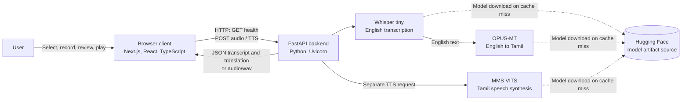
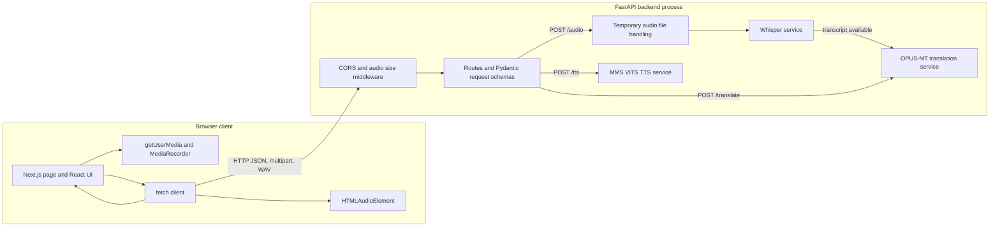
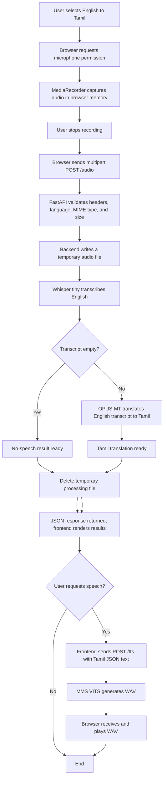
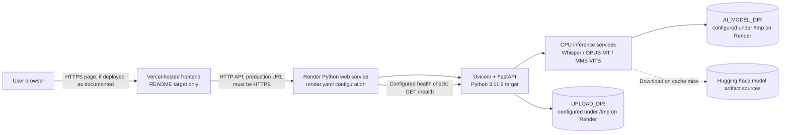

# System Architecture Document: AI Live Interpreter

**Document type:** System architecture description for an academic project report
**System version evidence:** Backend root endpoint reports version 1.2.0
**Repository review date:** 19 October 2026
**Scope:** Architecture implemented or explicitly configured in this repository

## Abstract

AI Live Interpreter is a browser-based speech interpretation application with an implemented English-to-Tamil workflow. The browser captures an English utterance as a completed audio recording, transfers the audio to a Python FastAPI backend over HTTP, and displays the returned English transcript and Tamil translation. A user may separately request Tamil speech synthesis and play the returned WAV audio. The backend runs OpenAI Whisper `tiny`, the Hugging Face OPUS-MT checkpoint `Helsinki-NLP/opus-mt-en-dra`, and the Hugging Face MMS VITS checkpoint `facebook/mms-tts-tam` locally, using CPU execution as configured by the services. The repository does not configure Argos Translate, continuous audio streaming, Tamil-to-English speech translation, or a confirmed live production deployment. This document describes the repository evidence and distinguishes current capabilities from recommendations.

**Keywords:** speech recognition, machine translation, text-to-speech, FastAPI, Next.js, Whisper, OPUS-MT, Tamil

## 1. Introduction and System Overview

### 1.1 Purpose and objectives

The purpose of this system is to convert a short English spoken utterance into an English transcript, Tamil text, and optionally synthesized Tamil speech through a web interface. It aims to provide a simple browser workflow for recording, translation review, copying text, and listening to generated speech.

Although the product name and interface include a language swap control, the current processing path supports English speech as input and Tamil as the translation target only. The architecture must therefore be understood as **English → Tamil**, not as a bidirectional Tamil ↔ English interpreter.

### 1.2 Scope and system boundary

The system boundary includes:

1. A web presentation client implemented with Next.js, React, and TypeScript.
2. Browser media APIs for microphone capture and playback.
3. A FastAPI backend that validates and coordinates requests.
4. Three backend-resident model services for speech recognition, translation, and speech synthesis.
5. Runtime retrieval of model artifacts from Hugging Face when they are not present in the configured local cache.

The system does not define a database, user accounts, durable transcript history, a streaming protocol, or an external inference service. The repository contains a Render backend service manifest and documents Vercel as the frontend deployment target, but it does not establish that either service is currently deployed.

### 1.3 Architectural style

The design follows a layered **client-server architecture** with synchronous HTTP request/response interactions. The browser performs capture and presentation; the backend performs request validation and orchestration; the AI services perform inference locally in the backend runtime. For a speech interpretation request, the backend processes a fully uploaded recording in sequence: audio decoding/transcription, then translation. Text-to-speech is invoked by a separate request.

**Figure 1. High-level system architecture.**



## 2. Architectural Layers

### 2.1 Presentation layer

The frontend is a Next.js App Router application. Its interactive page is a client-side React component written in TypeScript. CSS styles the application interface. The primary user functions are:

- Select source and target language labels; supported processing is restricted to English → Tamil.
- Grant microphone permission and record an utterance using `navigator.mediaDevices.getUserMedia` and `MediaRecorder`.
- Review the English transcript and Tamil translation, and copy either text to the clipboard.
- Request Tamil audio generation and play it through an `HTMLAudioElement`.
- Observe backend status and receive progress, success, and error messages.

Audio chunks are collected in browser memory while recording. After the user stops recording, the browser packages those chunks into a `Blob` and submits the completed audio. There is no partial transcript display or incremental audio upload.

The frontend obtains the backend base URL from `NEXT_PUBLIC_BACKEND_URL`; development falls back to `http://127.0.0.1:8000`. It uses `fetch` for the health, audio, and TTS routes. The component applies timeouts, aborts requests during cleanup, checks HTTP status and response shape, releases microphone tracks, and revokes audio object URLs. Microphone failures (for example permission denial, no device, device unavailable, or unsupported browser APIs) are surfaced through user-visible feedback.

### 2.2 Application and API layer

The backend is a Python FastAPI application served with Uvicorn. `backend/main.py` declares the endpoints, Pydantic request models, middleware, custom request-validation response, and workflow orchestration. CORS is provided by Starlette's `CORSMiddleware`; a custom ASGI middleware checks the `/audio` request's `Content-Length` before multipart parsing.

The browser and backend communicate through ordinary HTTP:

- `GET /health` returns JSON for the frontend connection indicator and Render health check.
- `POST /audio` accepts multipart form data and returns JSON transcript and translation fields.
- `POST /tts` accepts JSON and returns binary WAV audio.

Other backend endpoints are exposed for root metadata, direct text translation, audio status, and model load status. The inspected frontend does not call these additional routes. The backend performs speech transcription and translation in the `/audio` request; speech synthesis is intentionally separate and user-triggered.

The audio processing function is called through FastAPI's thread pool. The model services use lazy initialization and locks around model loading and inference. Errors from recognition, translation, and synthesis are logged using `logger.exception` and returned as service errors; validation errors are returned as generic `422` detail to avoid reflecting submitted request data.

### 2.3 AI and processing layer

| Function | Confirmed implementation | Execution details |
|---|---|---|
| Speech recognition | OpenAI Whisper via the `openai-whisper` Python package; model name `tiny` | `transcribe_audio` is called with `language="en"` and `fp16=False`. Audio decoding relies on FFmpeg; `imageio-ffmpeg` is used to make an executable alias when a system `ffmpeg` is not on `PATH`. |
| Machine translation | Hugging Face Transformers and PyTorch; checkpoint `Helsinki-NLP/opus-mt-en-dra` | English-to-Dravidian OPUS-MT checkpoint, with Tamil selected using `>>tam<<`. The model is moved to CPU, set to evaluation mode, and long input is chunked to fit limits. |
| Translation alternative check | Argos Translate | **Not configured or found.** There is no Argos Translate package dependency or Argos service in the inspected source. |
| Text-to-speech | Hugging Face Transformers `VitsModel` and PyTorch; checkpoint `facebook/mms-tts-tam` | Invoked only by `POST /tts`. The backend writes mono WAV data using the model sampling rate; the service documentation describes output as 16 kHz. The source identifies the model license as CC-BY-NC-4.0; license terms should be independently reviewed for intended use. |

All three model services lazily load model files when first needed, maintain model objects in backend-process memory, and use a configured local cache. OPUS-MT and MMS TTS use the Transformers cache beneath `AI_MODEL_DIR`; Whisper uses its own `whisper` subdirectory there. A cache miss may require model-file retrieval from Hugging Face. All neural inference is explicitly configured for CPU in the translation and TTS services; Whisper inference disables FP16.

### 2.4 Component architecture

The browser client communicates with the API over HTTP. Within the backend, middleware applies CORS and upload-size controls before route handling. The `/audio` route uses temporary audio-file handling, Whisper, and then OPUS-MT; `/translate` calls OPUS-MT directly; `/tts` calls the TTS service independently. Speech synthesis is not part of the `/audio` processing route.

**Figure 2. Component architecture and request paths.**



## 3. End-to-End Data Flow

### 3.1 Processing sequence

1. The user selects English as the source and Tamil as the target. The interface allows swapping labels, but recording and playback remain disabled for unsupported direction.
2. The browser requests microphone access and creates a `MediaRecorder`.
3. Audio is collected in memory until the user stops recording. No audio is sent while recording is ongoing.
4. The browser assembles the recording into a `Blob`, places it in multipart field `file`, appends `source_language` and `target_language`, and posts it to `/audio`.
5. The FastAPI middleware requires a single valid `Content-Length` header and rejects declared requests exceeding the configured request limit (file limit plus multipart allowance). The route checks the language values, `audio/*` content type, non-empty content, and actual file-size limit.
6. The backend writes the audio to a uniquely named temporary file and invokes Whisper with English as the recognition language.
7. If the transcript is empty, the backend prepares a `no_speech` result with empty text fields. Translation is skipped.
8. Otherwise the backend sends the transcript to OPUS-MT with the Tamil target-language token and prepares the transcript and translation result.
9. After audio processing completes (including the no-speech outcome), the backend removes the temporary processing file in a `finally` block before returning the result as JSON. If configured, a separate latest-recording file can be retained; the Render manifest disables this option.
10. The frontend validates the response and displays the transcript and translation or no-speech feedback. The user may copy either text result.
11. If the user requests playback, the frontend sends the Tamil text to `/tts`. The backend synthesizes audio and returns WAV bytes. The browser creates an object URL, plays it, and revokes that URL when playback completes, fails, is stopped, or the page is cleaned up.

### 3.2 Data-flow diagram

**Figure 3. Data flow for recording, transcription, translation, and optional synthesis.**



### 3.3 Interaction sequence

**Figure 4. Sequence of interactions for audio processing and optional TTS.**

```mermaid
sequenceDiagram
    actor User
    participant UI as Browser UI
    participant API as FastAPI backend
    participant STT as Whisper tiny
    participant MT as OPUS-MT
    participant TTS as MMS VITS

    User->>UI: Select English → Tamil
    User->>UI: Allow microphone; start recording
    UI->>UI: Capture audio with MediaRecorder
    User->>UI: Stop recording
    UI->>API: POST /audio (multipart file + language fields)
    API->>API: Validate and save temporary audio
    API->>STT: Transcribe as English
    STT-->>API: Transcript
    alt No speech detected
        API->>API: Remove temporary processing file
        API-->>UI: JSON status=no_speech; empty text/translation
        UI-->>User: Display no-speech feedback
    else Transcript available
        API->>MT: Translate transcript to Tamil
        MT-->>API: Tamil translation
        API->>API: Remove temporary processing file
        API-->>UI: JSON transcript + translation
        UI-->>User: Render both texts
        opt User presses play
            UI->>API: POST /tts (JSON Tamil text)
            API->>TTS: Synthesize speech
            TTS-->>API: WAV bytes
            API-->>UI: audio/wav response
            UI->>User: Play generated audio
        end
    end
```

## 4. Technology Stack and Implementation Status

Implementation status refers to evidence in the repository, not to planned product scope or a live deployment.

| Layer | Technology | Purpose | Implementation status |
|---|---|---|---|
| Presentation | Next.js App Router 16.3.8 | Frontend application framework | Implemented |
| Presentation | React and React DOM 19.2.8 | Interactive browser UI | Implemented |
| Presentation | TypeScript 5 (manifest range) | Frontend language | Implemented |
| Presentation | CSS / Tailwind CSS 4 dependency | Styling; project includes CSS and Tailwind tooling | Implemented |
| Browser audio | `getUserMedia`, `MediaRecorder`, `Blob`, `HTMLAudioElement` | Microphone permission, recording, and received-audio playback | Implemented |
| Backend runtime | Python 3.11.9 in Render configuration | Backend runtime target | Configured |
| API framework | FastAPI 0.141.1 | HTTP API and request orchestration | Implemented |
| API validation | Pydantic 2.13.4 | JSON request body validation | Implemented |
| ASGI server | Uvicorn 0.52.4 | Backend server | Configured |
| Speech recognition | `openai-whisper` 20250625; Whisper `tiny` | English speech-to-text | Implemented |
| Audio decoding | `imageio-ffmpeg` 0.6.0 / FFmpeg | Decode supported audio for Whisper | Implemented |
| Translation | Transformers 5.17.0, PyTorch 2.14.0, `Helsinki-NLP/opus-mt-en-dra` | English-to-Tamil translation | Implemented |
| Translation alternative | Argos Translate | Alternative translation runtime | Not found |
| Speech synthesis | Transformers `VitsModel`, PyTorch, `facebook/mms-tts-tam` | Tamil speech generation to WAV on request | Implemented |
| Transport | HTTP JSON, multipart form data, binary `audio/wav` | Browser-to-backend requests and responses | Implemented |
| Streaming transport | WebSocket, WebRTC, or streaming request/response | Continuous or incremental audio interpretation | Not found |
| Frontend deployment | Vercel | Hosting described in root README | Documented target; deployment not verified |
| Backend deployment | Render Blueprint in `render.yaml` | Backend service build/start/health configuration | Configured; deployment not verified |
| Automated testing | Python `unittest`; Vitest and Testing Library | Focused backend and frontend tests | Partially implemented |
| CI/CD | GitHub Actions workflow | Automated build/test/deployment pipeline | Not found |

## 5. API Architecture

### 5.1 Endpoint inventory

The route definitions below are in `backend/main.py`. The frontend actively calls `/health`, `/audio`, and `/tts`; other routes are defined for direct or operational use but are not called by the inspected frontend.

| HTTP method | Endpoint | Purpose | Request format | Success response | Principal error cases |
|---|---|---|---|---|---|
| GET | `/` | Backend identity and readiness summary | No body | JSON fields: `message`, `version`, `status`, `service` | No route-specific error handling is defined. |
| GET | `/health` | Liveness response used by frontend and Render | No body | `{"status":"healthy"}` | No route-specific error handling is defined. |
| GET | `/audio/status` | Indicates whether latest recording is retained | No body | `{"status":"no_audio","message":...}` or `status`, `filename`, `size` | No route-specific error handling is defined. |
| POST | `/translate` | Translate supplied English text to Tamil | JSON: `text` (1–5000 chars), optional `target_language` (default `ta`, maximum 16 chars) | JSON: `text`, `translation`, `source_language`, `target_language` | `422` invalid request or unsupported target; `503` local translation failure. |
| POST | `/audio` | Transcribe English audio and translate it to Tamil | Multipart fields: required `file`; `source_language` default `en`; `target_language` default `ta` | JSON: `status`, `text`, `translation`, `source_language`, `target_language`, `message`, `filename`, `size`. Status is `success` or `no_speech`. | `400` invalid/duplicate Content-Length or empty upload; `411` missing Content-Length; `413` request/file exceeds limit; `415` non-audio MIME type; `422` invalid form/language or audio content that is malformed, mismatched, or cannot be decoded; `500` temporary file write failure; `503` audio validation, recognition, or translation failure. |
| GET | `/translation/status` | Reports translation model load state in this process | No body | JSON: `status`, `model`, `target_language` | No route-specific error handling is defined. |
| POST | `/tts` | Generate Tamil speech | JSON: `text` (1–1000 chars) | Binary WAV response with `Content-Type: audio/wav` and inline filename header | `422` invalid request/text or unsupported text; `503` local speech synthesis failure. |
| GET | `/tts/status` | Reports speech model load state in this process | No body | JSON: `status`, `model`, `language` | No route-specific error handling is defined. |

For `/audio`, `MAX_AUDIO_BYTES` defaults to 25 MiB. The request middleware checks the declared request length against the audio limit plus a 1 MiB multipart-overhead allowance. The endpoint then reads at most `MAX_AUDIO_BYTES + 1` bytes and enforces the actual audio content limit. `filename` is set to `latest_recording.webm` in the response even when latest-recording retention is disabled; retention is controlled separately.

Before retaining or transcribing an upload, the backend uses the FFmpeg bundled by `imageio-ffmpeg` to decode the declared container and require non-zero decoded audio duration. The decoder is limited to 60 seconds; an unsupported, malformed, mismatched, or timed-out file is rejected with `422`. This is a bounded format/playability check, not a guarantee that every downstream speech model can process the recording.

The application-level request-validation handler returns `422` with the generic response `{"detail":"The request data is invalid."}`. Handled `HTTPException` responses use a JSON `detail` value. OpenAPI docs (`/docs`, `/redoc`, `/openapi.json`) are available only when enabled by configuration; the Render manifest disables them.

### 5.2 Frontend-to-backend communication

The frontend uses the configured `NEXT_PUBLIC_BACKEND_URL` as the origin. The recording upload uses `fetch` with `FormData`; the browser supplies the multipart boundary. TTS uses a JSON request with `Content-Type: application/json`. Successful TTS responses are validated as WAV and played with a browser audio element. The client does not call `/translate` or either model status route in the inspected page.

Client timeouts are four seconds for health checks, ten minutes for audio processing, and five minutes for speech synthesis. Network failures, timeout/cancellation, malformed JSON, service errors, and unsupported result states are surfaced as user-facing feedback. There is no background job polling, request queue, WebSocket, or server-sent event transport.

## 6. Deployment and Infrastructure

### 6.1 Repository configuration and deployment status

`render.yaml` defines a Python web service named `ai-live-interpreter-api`, with `backend` as its root directory. It installs CPU PyTorch using the PyTorch CPU package index and installs the pinned `backend/requirements.txt`, then runs Uvicorn on the platform port (fallback 10000) and configures `/health` as a health-check path.

The root README documents Vercel as the intended frontend host. A Vercel-specific manifest is not present in the tracked repository. Deployment dashboards and URLs are not part of source evidence, so neither active Vercel nor active Render deployment is asserted here. There is no tracked GitHub Actions workflow.

**Figure 5. Deployment view represented by repository configuration and documented intent.**



### 6.2 Environment configuration

| Variable | Scope | Behavior in source/configuration |
|---|---|---|
| `NEXT_PUBLIC_BACKEND_URL` | Frontend build/runtime bundle | Backend origin. Production prebuild validation requires a valid HTTPS origin without credentials, a non-root path, query, or fragment. Development fallback in the page is `http://127.0.0.1:8000`. |
| `APP_ENV` | Backend | `development` or `production`; defaults to development and rejects other values. |
| `CORS_ORIGINS` | Backend | Comma-separated exact origins; required in production, and production origins must be HTTPS. Wildcards, embedded credentials, paths, queries, and fragments are rejected. |
| `ENABLE_API_DOCS` | Backend | Enables/disables FastAPI docs and OpenAPI routes; defaults enabled in development and disabled in production. |
| `MAX_AUDIO_BYTES` | Backend | Positive audio-content byte limit; defaults to 26,214,400 bytes (25 MiB). |
| `AI_MODEL_DIR` | Backend | Model directory root; defaults to `backend/models`. Render config sets `/tmp/ai-live-interpreter-models`. |
| `UPLOAD_DIR` | Backend | Temporary and optional retained audio directory; defaults to `backend/uploads`. Render config sets `/tmp/ai-live-interpreter-uploads`. |
| `KEEP_LATEST_RECORDING` | Backend | Enables latest recording retention/status; defaults enabled in development and disabled in production. Render config sets it to false. |
| `PYTHON_VERSION` | Render runtime | Render config specifies Python 3.11.9. |
| `PORT` | Render runtime | Read by the configured Uvicorn start command; fallback port is 10000. |

No credentials or API keys are required by the source-configured model integrations. The example environment files contain configuration placeholders only. `/tmp` storage is instance-local and no persistent disk is configured in `render.yaml`; cache contents and uploaded files should not be presumed durable across instance replacement or restart.

### 6.3 Runtime communication and infrastructure constraints

The browser connects directly to the backend origin over HTTP; there is no server-side frontend proxy in the inspected page. The production build validates an HTTPS backend URL. The CORS middleware allows only configured origins, methods `GET`, `POST`, and `OPTIONS`, and the `Content-Type` header; credentials are disabled.

Model inference runs in the backend host rather than through a managed inference API. The Render build uses CPU PyTorch and does not configure GPU resources. The repository does not configure persistent model storage, autoscaling, a job queue, or capacity thresholds. Model download duration, service sleep/cold-start behavior, memory availability, and throughput depend on the hosting plan and must be measured or verified outside this repository.

## 7. Security, Reliability, and Performance

### 7.1 Implemented controls

1. **Microphone consent and browser feedback:** `getUserMedia` prompts for user permission. The frontend reports permission denial, missing or unavailable devices, and unsupported recording APIs.
2. **CORS controls:** Configured exact origins are used; production requires HTTPS origins and rejects wildcard entries. Credentials are not enabled.
3. **Audio request limits:** The backend checks the request `Content-Length` before multipart parsing; it rejects absent, duplicate, malformed, or oversized declared lengths. It separately enforces actual audio size after reading.
4. **Upload and language validation:** The backend requires an `audio/*` content type and non-empty audio, and restricts the audio pipeline to English input and Tamil output.
5. **Temporary-file cleanup:** The processing file is removed in `finally`. Latest-recording retention is configurable and disabled in the Render manifest.
6. **Validation response minimization:** FastAPI request validation is converted to generic detail to avoid echoing submitted speech text through validation errors.
7. **Service error handling:** Model failures are logged with exception details server-side and returned as generic `503` messages. Unsupported or malformed inputs produce client errors.
8. **Frontend resilience:** The UI checks response status and payload shape, has operation-specific timeouts, supports aborting TTS generation, and cleans up audio tracks/object URLs.
9. **Production configuration checks:** The frontend build requires a valid HTTPS backend origin; backend production startup requires valid CORS configuration. `poweredByHeader` is disabled in Next.js.

### 7.2 Reliability and performance constraints

- The user must finish recording before the audio is submitted. End-to-end delay includes recording duration, upload time, model loading (on cold process), transcription, and translation.
- TTS adds a separate request and synthesis stage after the translation is displayed.
- CPU-based model inference may be resource-intensive. The model-specific inference locks serialize inference within the respective process/model instance; concurrent-user capacity is not measured.
- A process health response indicates service liveness only; model status endpoints report whether each model is loaded in process memory, but the configured Render health check uses `/health`.
- Models are loaded lazily and may download on a cache miss. Render paths use `/tmp`, and persistent storage is not configured.
- The repository does not provide benchmarks, latency objectives, load testing, production monitoring, user authentication, rate limiting, or abuse quotas.
- Audio can be retained when `KEEP_LATEST_RECORDING` is enabled. The Render manifest disables retention, but privacy/retention guarantees depend on deployment configuration and host behavior.
- The TTS service source identifies the selected checkpoint as CC-BY-NC-4.0. Redistribution and commercial deployment require license review.

### 7.3 Recommended improvements (not implemented)

- Define and publish audio-processing consent, privacy, and retention policies.
- Add authentication and rate limiting if the service is exposed publicly.
- Benchmark cold start, model load, transcription, translation, TTS, memory use, and concurrency using the intended hosting plan.
- Add model readiness reporting or a separate readiness endpoint if operational requirements warrant it.
- Add metrics, request correlation identifiers, monitoring, and alerting without logging raw audio or sensitive transcripts.
- Consider persistent or pre-provisioned model artifacts to avoid repeated cache misses, subject to deployment platform support.
- Review the model license and choose a compatible speech model if commercial use is planned.
- Expand API integration and workflow testing before treating the system as production-ready.

## 8. Testing and Verification

The repository contains focused tests, but does not demonstrate a full integration test that executes live model inference for a recorded request:

| Test area | Repository evidence | Coverage indicated |
|---|---|---|
| Backend configuration | `backend/tests/test_config.py` using Python `unittest` | Development defaults, production CORS requirements, boolean and upload-size validation, configured paths. |
| Upload middleware | `backend/tests/test_upload_limit.py` using `unittest.IsolatedAsyncioTestCase` | Missing, duplicate, oversized, and acceptable `Content-Length` handling. |
| Whisper helper | `backend/tests/test_whisper_service.py` | Platform-specific FFmpeg executable alias naming. |
| Frontend component | `frontend/app/components/interpreter-ui.test.tsx` using Vitest and Testing Library | Clipboard behavior for transcript/translation, disabled empty-copy actions, and permission failure feedback. |
| Frontend scripts | `frontend/package.json` | `npm test` runs Vitest; `npm run lint` runs ESLint; `npm run build` runs Next.js build after production environment validation. |

The tests do not establish model translation quality, recognition accuracy, end-to-end latency, deployed CORS behavior, full `/audio` or `/tts` contract correctness, or production concurrency. These remain appropriate subjects for future integration, acceptance, and performance testing.

## 9. Limitations and Future Enhancements

### 9.1 Current limitations

- The implemented language direction is English-to-Tamil only. The UI swap control does not add Tamil-to-English inference.
- Audio capture is record-then-upload; continuous streaming, partial transcripts, and simultaneous interpretation are not implemented.
- Tamil TTS is a separate user-initiated operation rather than an automatic stage of `/audio`.
- `/translate`, `/audio/status`, `/translation/status`, and `/tts/status` are backend routes but are not called by the frontend page.
- OPUS-MT is the configured translation engine. Argos Translate is not included or configured.
- Models execute locally in the backend process and are CPU-configured. Hardware capacity, model quality metrics, and concurrency limits are unspecified.
- Model files may be downloaded at runtime; `/tmp` cache paths are configured for Render without a persistent disk.
- There is no database, durable history, user identity, authentication, or public API abuse control in the tracked implementation.
- Vercel deployment is documented but not configured in the tracked files; Render is configured, but the live status and resources cannot be verified from the repository.
- The tests are focused and do not exercise the complete model-backed HTTP workflow or deployment environment.
- The source identifies the TTS checkpoint as non-commercially licensed; suitability depends on use and license review.

### 9.2 Future enhancements (proposed)

1. Implement Tamil speech recognition and Tamil-to-English translation before describing the application as bidirectional.
2. Evaluate additional Indian languages with language-appropriate ASR, translation, and TTS models and measured quality criteria.
3. Explore streaming or incremental interpretation only after selecting compatible model runtimes and defining partial-result, cancellation, and failure semantics.
4. Improve latency with measured model selection, inference optimization, cache strategy, and suitable hosting hardware.
5. Add API contract tests, model-service integration tests, end-to-end browser tests, and performance/load tests.
6. Add production controls such as authentication, rate limiting, monitoring, operational readiness checks, and retention policy enforcement.
7. Review model licenses and select commercially compatible alternatives if required.
8. Extend audio UX with playback controls, download support, accessibility refinements, and explicit recording-duration guidance.

## 10. Conclusion

AI Live Interpreter is a layered web application in which a Next.js/React/TypeScript browser client captures completed English audio and communicates with a Python FastAPI backend through HTTP. The backend validates the request and runs local Whisper `tiny` transcription followed by OPUS-MT English-to-Tamil translation. Tamil speech is generated by the local `facebook/mms-tts-tam` model only after a separate playback request, which returns WAV audio to the browser. The repository configures a Render backend service and documents Vercel as the frontend target, but does not prove live production deployment. Accordingly, the current architecture is a record-and-process English-to-Tamil workflow; bidirectional translation, continuous streaming, persistent user history, and measured production scalability are not implemented.

## Appendix A. Repository Evidence and Unverified Deployment Facts

The architectural description was cross-checked against `backend/main.py`, `backend/config.py`, `backend/whisper_service.py`, `backend/translation_service.py`, `backend/tts_service.py`, `backend/requirements.txt`, `frontend/app/page.tsx`, `frontend/app/components/interpreter-ui.tsx`, `frontend/package.json`, `frontend/scripts/validate-production-env.mjs`, `render.yaml`, and the frontend/backend example environment files. Tests cited in Section 8 were inspected in `backend/tests/` and the frontend component test file.

Repository files do not establish the active production URLs, deployed service state, actual Render plan, resource limits, persistent storage settings outside the manifest, live environment values, user traffic, model accuracy, end-to-end latency, or capacity. These must be confirmed from hosting dashboards and operational measurements. No secret values are reproduced here.
